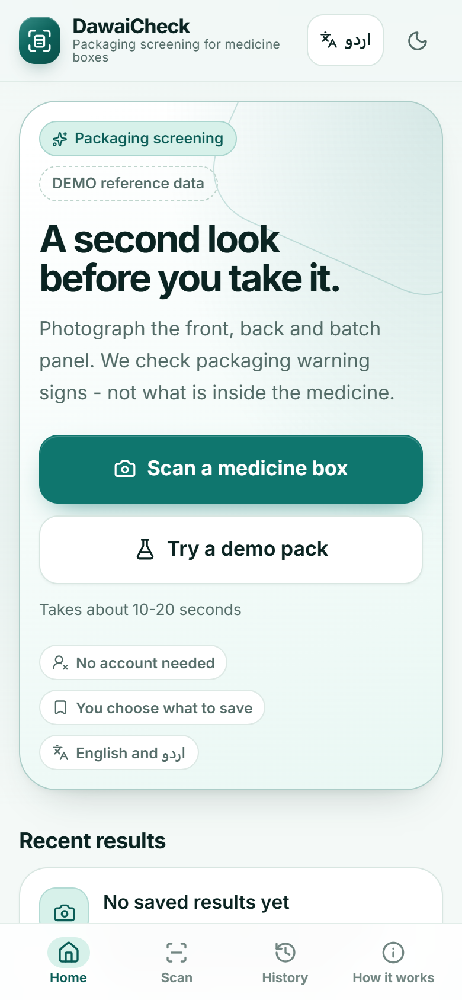
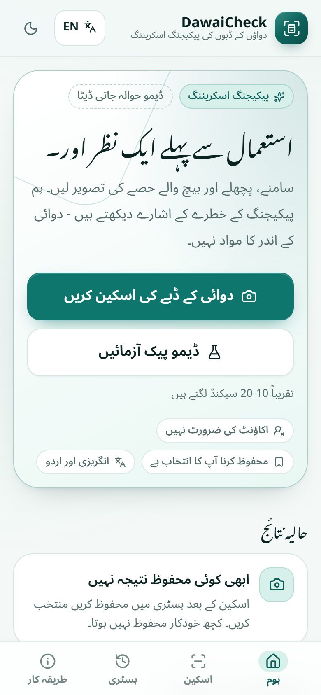
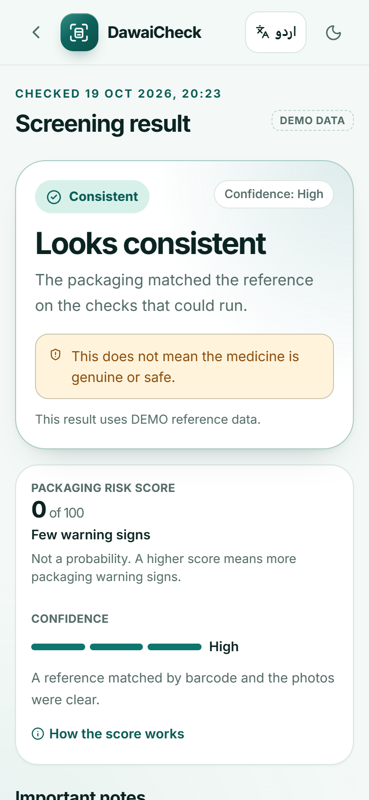

# DawaiCheck Technical Documentation

**Version:** 0.1.0  
**Project type:** Final-year / portfolio prototype  
**Platform:** Responsive web PWA with FastAPI backend

> **Medical and safety disclaimer:** DawaiCheck is a packaging screening aid, not a laboratory test. It cannot test chemical content, prove that a medicine is genuine, or prove that a medicine is safe. All products, registration numbers, and images bundled with this repository are fictional DEMO DATA. Always confirm doubts with a licensed pharmacist or DRAP.

## Contents

1. [Product overview](#1-product-overview)
2. [Screenshots](#2-screenshots)
3. [System architecture](#3-system-architecture)
4. [Repository structure](#4-repository-structure)
5. [How an analysis works](#5-how-an-analysis-works)
6. [Risk scoring](#6-risk-scoring)
7. [Frontend architecture](#7-frontend-architecture)
8. [Backend API](#8-backend-api)
9. [Demo dataset](#9-demo-dataset)
10. [Local setup](#10-local-setup)
11. [Configuration](#11-configuration)
12. [Testing and verification](#12-testing-and-verification)
13. [Docker deployment](#13-docker-deployment)
14. [Privacy and security](#14-privacy-and-security)
15. [Accessibility and bilingual UX](#15-accessibility-and-bilingual-ux)
16. [Known limitations](#16-known-limitations)
17. [Troubleshooting](#17-troubleshooting)
18. [Publishing to GitHub](#18-publishing-to-github)
19. [Delivery checklist](#19-delivery-checklist)

---

## 1. Product overview

DawaiCheck helps a user photograph a medicine pack and review visible packaging warning signs before taking or buying it. The system focuses on the **outside of the pack**, not its chemical contents.

The MVP supports:

- Front, back, and batch/expiry photos (mandatory).
- An optional blister/strip photo.
- Device-side photo quality guidance.
- OCR field extraction, barcode/DataMatrix decoding, reference matching, date checks, spelling comparison, and perceptual visual similarity.
- A risk score from 0 to 100 with three user-facing outcomes:
  - **Looks consistent** — no strong packaging warning signs were found.
  - **Suspicious packaging** — one or more important checks failed or warned.
  - **Undetermined** — there was not enough reliable information to make a useful screening statement.
- English and Urdu interfaces, including RTL layout.
- Local-only result history in IndexedDB.
- Text sharing and an English-only PDF summary.

The product deliberately avoids words such as "safe", "genuine", or "verified". A consistent result is always paired with a warning that packaging alone cannot prove authenticity or safety.

## 2. Screenshots

| Home | Urdu / RTL | Consistent result |
| --- | --- | --- |
|  |  |  |

## 3. System architecture

```text
┌────────────────────────────── Browser ──────────────────────────────┐
│  React 19 + TypeScript + Vite PWA                                  │
│                                                                    │
│  Onboarding → Home → Capture → Analyzing → Result → Report         │
│                     │                     │                        │
│                     │ IndexedDB           │ jsPDF (client-side)    │
│                     ▼                     ▼                        │
│               Local history         PDF / share text               │
└─────────────────────────────┬──────────────────────────────────────┘
                              │ multipart /api/analyze
                              ▼
┌──────────────────────────── FastAPI ────────────────────────────────┐
│  Analyze router                                                     │
│    ├─ Image validation + EXIF orientation + resizing                │
│    ├─ OCR (RapidOCR by default, optional Tesseract)                 │
│    ├─ Barcode/DataMatrix decoding                                   │
│    ├─ Field parsing + reference selection                          │
│    ├─ Image quality / expiry / dates / barcode / registration      │
│    ├─ Spelling / visual comparison / print quality                 │
│    └─ Transparent scoring + notices                                 │
│                                                                     │
│  Reference store (JSON + image files)                              │
│  Demo registry (CSV)                                                │
└─────────────────────────────────────────────────────────────────────┘
```

In development, Vite proxies `/api` to `http://127.0.0.1:8000`. In Docker, Nginx serves the static PWA and proxies `/api` to the backend service.

## 4. Repository structure

```text
dawaicheck/
├─ backend/
│  ├─ app/
│  │  ├─ config.py                 Settings and paths
│  │  ├─ main.py                   FastAPI app factory/lifespan
│  │  ├─ models.py                 Pydantic response models
│  │  ├─ routers/                  analyze, references, meta
│  │  ├─ services/                 OCR, barcode, visual, scoring, registry
│  │  └─ config/scoring.json       Public scoring weights and thresholds
│  ├─ data/                        Bundled demo references and registry CSV
│  ├─ tests/                       Pytest suite
│  ├─ requirements.txt
│  └─ Dockerfile
├─ frontend/
│  ├─ src/
│  │  ├─ components/               App shell, dialogs, controls, result cards
│  │  ├─ context/                  App settings and toast providers
│  │  ├─ i18n/                     English and Urdu dictionaries
│  │  ├─ lib/                      API, IndexedDB, reporting, images, utilities
│  │  ├─ pages/                    All route screens
│  │  └─ index.css                 Tailwind + design tokens + components
│  ├─ public/                      PWA icons, favicon, demo photos
│  ├─ vite.config.ts               PWA manifest, Workbox, dev proxy
│  ├─ nginx.conf
│  └─ Dockerfile
├─ demo_data/                      Reference and tampered source images + manifest
├─ docs/                           Documentation, screenshots, evaluation results
├─ scripts/                        Dataset generation and evaluation helpers
├─ compose.yaml
├─ .env.example
├─ .dockerignore
├─ .gitignore
└─ README.md
```

## 5. How an analysis works

1. **Photo capture**  
   The user adds front, back, and batch/expiry photos. The frontend checks resolution, blur, brightness, glare, and framing where possible. Severe quality failures require a retake; the user may still explicitly continue in some cases.

2. **Upload**  
   The browser sends a multipart request to `POST /api/analyze`. Images are limited to 15 MB each by default and resized so the longest side is at most 2400 px.

3. **OCR**  
   RapidOCR is used automatically by default. Tesseract is optional. The backend extracts text, confidence, and language-independent lines.

4. **Barcode / DataMatrix**  
   The decoder attempts to read a GTIN or data payload. A match strongly narrows the reference candidates.

5. **Reference selection**  
   A reference can be matched by barcode, product name, or registration text. The API also accepts an explicit `reference_id` for controlled demo flows.

6. **Checks**  
   Each check produces `pass`, `warn`, `fail`, or `unknown`:
   - Photo quality
   - Expiry
   - Date consistency
   - Batch format
   - Barcode
   - Registration
   - Spelling
   - Visual artwork similarity
   - Print quality

7. **Scoring**  
   Failed and warning checks add weighted risk. Unknown checks do not add risk but reduce confidence. The verdict and confidence are returned with human-readable notices.

8. **Result**  
   The frontend renders the verdict, score, confidence, check list, comparisons, and safety notices. Saving requires explicit consent and stores compressed photos locally.

## 6. Risk scoring

The public configuration lives in `backend/app/config/scoring.json` and is exposed through `GET /api/scoring`.

| Check | Weight |
| --- | ---: |
| Photo quality | 0 |
| Expiry | 18 |
| Dates | 8 |
| Batch format | 8 |
| Barcode | 10 |
| Registration | 12 |
| Spelling | 12 |
| Visual artwork | 22 |
| Print quality | 10 |

Status factors:

| Status | Factor |
| --- | ---: |
| pass | 0.0 |
| warn | 0.5 |
| fail | 1.0 |
| unknown | 0.0 |

A score of **15 or more** is suspicious. The score is a packaging-risk indicator, not a probability that the medicine is counterfeit.

## 7. Frontend architecture

### Routes

| Path | Screen |
| --- | --- |
| `/onboarding` | Safety and privacy introduction |
| `/` | Home and demo picker |
| `/scan` | Capture checklists |
| `/capture` | Alias that redirects to `/scan` |
| `/analyzing` | Upload and progress state |
| `/result` | Screening result |
| `/saved/:id` | Saved result from IndexedDB |
| `/history` | Local saved results |
| `/report` | Report/share/PDF summary |
| `/admin` | Hidden reference administration |
| `/how-it-works` | Explanation, scoring, limitations |
| `*` | Not found |

### State and storage

- `AppContext` handles language, theme, online state, pending photos, and the last analysis session.
- `ToastContext` provides non-blocking feedback.
- `IndexedDB` (`dawaicheck_history`) stores up to 20 scans and compressed photos.
- Preferences are stored under `dawaiicheck_lang`, `dawaiicheck_theme`, and `dawaiicheck_admin_link`.
- `sessionStorage` keeps the current analysis session so the result page can survive a reload without being permanently stored.

### PWA

`vite-plugin-pwa` generates the service worker and manifest. The app shell and static assets are precached. API calls use a `NetworkOnly` strategy because analysis must be live and user photos must not be cached by the service worker.

### Reports

The PDF is generated entirely in the browser using jsPDF and autoTable. It is intentionally English-only so the bundled fonts remain reliable. The UI explains this before download. Nothing is uploaded to produce the report.

### Admin

The admin link is hidden by default. It can be enabled from **How it works**. Built-in demo references are read-only and cannot be deleted. User-added references are stored on the backend and can be deleted through the API/admin screen.

## 8. Backend API

Base prefix: `/api`

| Method | Endpoint | Notes |
| --- | --- | --- |
| `GET` | `/health` | Status, version, OCR engine, registry provider, reference count, demo flag |
| `GET` | `/scoring` | Public weights, status factors, thresholds |
| `GET` | `/registry/lookup?number=...` | Local demo CSV lookup |
| `POST` | `/analyze` | Multipart images plus optional `overrides`, `reference_id` |
| `GET` | `/references` | Public reference summaries |
| `POST` | `/references` | Add a non-demo reference |
| `GET` | `/references/{id}` | One reference |
| `GET` | `/references/{id}/image/{view}` | `front`, `back`, or `batch` image |
| `DELETE` | `/references/{id}` | Delete a user reference; `204` on success |

### Analyze form

| Field | Required | Description |
| --- | --- | --- |
| `front` | Yes | Front-of-pack image |
| `back` | Yes | Back-of-pack image |
| `batch` | Yes | Batch/expiry panel |
| `blister` | No | Optional blister/strip |
| `overrides` | No | JSON object for manually corrected fields |
| `reference_id` | No | Force a known reference for controlled flows |

Interactive API documentation is available at `/docs` while the backend is running.

## 9. Demo dataset

`demo_data/manifest.json` drives seeding. The fictional reference products are:

- Fevra+
- Allerfree
- Cardiosafe
- Coughcalm
- Glucobalance

Frontend demo cases under `frontend/public/demo/`:

| Case | Files | Expected |
| --- | --- | --- |
| Authentic | `authentic-front/back/batch.png` | Looks consistent |
| Typo | `typo-front/back/batch.png` | Suspicious: spelling |
| Expired | `expired-front/back/batch.png` | Suspicious: expiry/dates |
| Wrong color | `wrong-color-front/back/batch.png` | Suspicious: visual |

**Important:** keep these files as PNG. JPEG compression previously damaged small text (`DEMO` was read as `DEM0`) and introduced false visual/print warnings in API tests.

## 10. Local setup

### Prerequisites

- Python 3.12 or newer (tested with 3.14.7)
- Node.js 22 or newer (tested with 24.21.0)
- npm 10 or newer
- Optional: Tesseract OCR and the Urdu language pack
- Optional: Docker Desktop for container deployment

### Backend

```powershell
cd backend
python -m venv .venv
.\.venv\Scripts\Activate.ps1
pip install -r requirements.txt
uvicorn app.main:app --reload --host 127.0.0.1 --port 8000
```

Linux/macOS activation:

```bash
source .venv/bin/activate
```

Health check: `http://127.0.0.1:8000/api/health`  
API docs: `http://127.0.0.1:8000/docs`

### Frontend

```powershell
cd frontend
npm ci
npm run dev
```

Open `http://localhost:5173`. Camera preview requires HTTPS or localhost; photo upload works without a camera.

### Production-mode preview

```powershell
cd frontend
npm run build
npm run preview
```

The preview server still uses the configured `/api` proxy.

## 11. Configuration

Backend settings are read from `.env` at the project root or from environment variables.

| Variable | Default | Description |
| --- | --- | --- |
| `API_PREFIX` | `/api` | API route prefix |
| `DATA_DIR` | `backend/data` | Reference and registry storage |
| `DEMO_MANIFEST` | `demo_data/manifest.json` | Demo seeding manifest |
| `REGISTRY_PROVIDER` | `local_demo` | Demo CSV registry adapter |
| `OCR_ENGINE` | `auto` | `auto`, `rapidocr`, `tesseract`, `none` |
| `OCR_LANGUAGES` | `eng+urd` | Tesseract language packs |
| `OCR_MIN_CONFIDENCE` | `0.35` | Minimum usable OCR confidence |
| `MAX_UPLOAD_MB` | `15` | Maximum size per photo |
| `MAX_SIDE_PX` | `2400` | Server-side resize limit |
| `SEED_DEMO_ON_STARTUP` | `true` | Seed references when the store is empty |
| `CORS_ORIGINS` | localhost dev origins | Comma-separated allowed origins |
| `VISION_LLM_ENABLED` | `false` | Optional vision fallback |
| `VISION_LLM_API_KEY` | empty | API key for the optional fallback |
| `VISION_LLM_MODEL` | `gpt-4o-mini` | Optional fallback model |

Frontend:

| Variable | Default | Description |
| --- | --- | --- |
| `VITE_API_BASE_URL` | `/api` | API base URL; keep same-origin when proxied |

**Never commit `.env` or real API keys.** Only `.env.example` is included.

## 12. Testing and verification

### Backend

```powershell
cd backend
.\.venv\Scripts\python.exe -m pytest -q
```

Latest result: **20 passed, 1 third-party deprecation warning**.

The E2E test requires an installed OCR engine. It checks:

- Health and reference seeding
- Authentic demo pack: consistent, risk 0
- Typo pack: suspicious spelling failure
- Expired pack: suspicious expiry/date failure
- Wrong-color pack: suspicious visual failure

### Frontend

```powershell
cd frontend
npm run typecheck
npm run lint
npm run build
```

Latest verification:

- TypeScript: pass
- ESLint: 0 errors, 2 non-blocking React Fast Refresh warnings in context files
- Production build: pass, PWA service worker generated

### Browser / PWA verification

A headless Edge/Playwright run verified:

- Home and demo picker
- Authentic analysis result: **Looks consistent**, score 0
- Save consent and local history
- PDF download (`DawaiCheck-report-*.pdf`)
- Urdu switch with `lang="ur"` and `dir="rtl"`
- Desktop navigation visible, bottom navigation hidden
- Manifest: `DawaiCheck`, `standalone`, 3 icons
- Service worker controlling the page
- Offline reload of the app shell and offline banner
- No browser console errors

## 13. Docker deployment

```powershell
docker compose up --build
```

| Service | Container port | Host URL |
| --- | --- | --- |
| Frontend (Nginx) | 80 | `http://localhost:8080` |
| Backend (FastAPI) | 8000 | `http://localhost:8000` |

The backend image installs `libgomp1`, Tesseract, and Urdu language data. A named volume (`backend_data`) preserves user-added references between container restarts.

Compose configuration was validated with `docker compose config --quiet`. A full image build was not run in the delivery environment because the Docker daemon was not running. Start Docker Desktop and run the command above to complete deployment verification.

Stop containers:

```powershell
docker compose down
```

Delete the reference volume only when intentionally resetting admin data:

```powershell
docker compose down -v
```

## 14. Privacy and security

- Photos are sent only to the configured backend for analysis.
- The backend does not write analysis photos to a history store. `ANALYSIS_RETENTION_SECONDS` defaults to `0`.
- Saved results and compressed photos remain in the browser's IndexedDB.
- History is capped at 20 entries and can be deleted locally.
- The report/PDF is generated client-side.
- No accounts, analytics, or tracking scripts are included.
- `.env` and runtime secrets are excluded from version control.
- Uploads are type-checked, size-limited, EXIF-oriented, and resized.
- Reference paths are resolved and checked to remain inside the reference root.
- The demo registry is not a real DRAP connection.

For production, terminate TLS at a reverse proxy, set a strict CORS allow-list, add rate limiting, and run malware scanning on uploads.

## 15. Accessibility and bilingual UX

- Minimum 48 px interactive targets.
- Base body text at least 16 px.
- Semantic headings, labels, focus styles, and dialog titles.
- Skip-to-content link.
- Dark and light themes.
- Full English/Urdu dictionaries (641 keys each).
- RTL layout via `dir="rtl"` with mirrored navigation and spacing.
- Numerals and dates localized for display where supported.
- Status is communicated with text and iconography, not color alone.
- The result disclaimer remains visible at the bottom of result/report screens.

## 16. Known limitations

- Packaging checks cannot detect counterfeit contents, incorrect ingredients, degradation, or unsafe storage.
- OCR and visual matching are sensitive to lighting, blur, glare, angle, and print variation.
- The visual comparison uses the supplied reference images and is not a forensic authentication method.
- The bundled registry is fictional demo data; no real DRAP API adapter is included.
- The optional visual-LLM fallback is disabled by default and may send image data to a third party if enabled.
- PDF output is English-only for font reliability.
- Camera preview availability depends on browser permissions and secure context.
- This is a prototype, not a medical device or regulatory product.

## 17. Troubleshooting

### Backend says `reference_count: 0`

Delete the local persisted store or set `SEED_DEMO_ON_STARTUP=true`, then restart the backend. For Docker, remove the `backend_data` volume only if you do not need user-added references.

### OCR is unavailable or slow

Install Tesseract plus Urdu data, or use the bundled RapidOCR engine. The first analysis can take longer while models load.

### Frontend shows API errors

Confirm the backend is running on port 8000. In development, Vite must proxy `/api`; in Docker, Nginx must reach the `backend` service.

### Camera preview does not open

Use `localhost` or HTTPS. The upload/device-camera fallback still works without live preview.

### PDF download fails

Check browser download permissions and storage. The PDF is generated locally and may take a few seconds.

### PWA does not work offline

Load the production build over localhost/HTTPS, reload once so the service worker takes control, then test. Development mode has a different service-worker lifecycle.

### Docker build cannot connect

Start Docker Desktop and confirm `docker info` works before running `docker compose up --build`.

## 18. Publishing to GitHub

The project is not currently a Git repository. From the project root:

```powershell
git init
git add .
git commit -m "Initial DawaiCheck implementation"
git branch -M main
git remote add origin https://github.com/<your-username>/<repository-name>.git
git push -u origin main
```

Keep these excluded:

- `.env` and API keys
- `node_modules/`
- `backend/.venv/`
- `frontend/dist/`
- caches and logs

`.gitignore` already covers these paths.

After pushing, a reviewer can run:

```powershell
cd backend
python -m venv .venv
.\.venv\Scripts\Activate.ps1
pip install -r requirements.txt
uvicorn app.main:app --reload
```

and in another terminal:

```powershell
cd frontend
npm ci
npm run dev
```

## 19. Delivery checklist

- [x] FastAPI backend and demo data
- [x] React/TypeScript PWA frontend
- [x] English/Urdu i18n and RTL
- [x] Disclaimer and safety language
- [x] Local history and consent
- [x] PDF and share flows
- [x] PWA icons, manifest, service worker
- [x] Demo PNG assets
- [x] Backend tests
- [x] Frontend typecheck, lint, build
- [x] Browser and offline verification
- [x] README and technical documentation
- [x] Docker, Nginx, Compose, and environment examples
- [ ] Full Docker image runtime verification (requires running Docker daemon)
